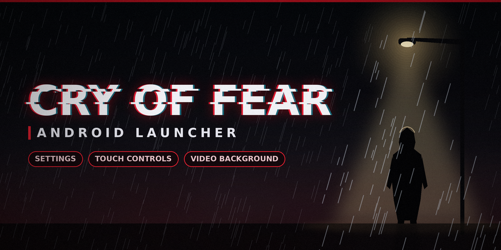

  

# Cry of Fear — Android Launcher

Launcher **tidak resmi** untuk *Cry of Fear* dengan pengaturan game (resolusi, FPS, aspect ratio, refresh rate), background video, dan layout kontrol sentuh.

Satu APK berisi tiga hal: launcher (Kotlin + Jetpack Compose), engine [Xash3D FWGS](https://github.com/FWGS/xash3d-fwgs), dan library game dari [TimRol83/cry-of-fear-src](https://github.com/TimRol83/cry-of-fear-src) (penulisan ulang kode game, masih eksperimental).

> Tidak ada file game di repo ini. Kamu butuh salinan *Cry of Fear* sendiri (folder `cryoffear`).

## Build

Actions > **Build Cry of Fear (satu APK)** > Run workflow. Hasilnya artifact `CoF-Launcher-APK`.

Opsional, supaya update berikutnya bisa menimpa tanpa uninstall: tambah secret `KEYSTORE_B64` dan `KS_PASS` (Settings > Secrets and variables > **Actions**).

## Kontrol

Tombol sentuh ala PS2 (stik analog, D-pad, ✕ ○ □ △, L1/L2/R1/R2, Start/Select), plus gamepad Bluetooth/USB dan keyboard + mouse. Launcher memasang `touch_ps2.cfg` dan `cof_input.cfg` ke folder `cryoffear`. Mau reset tata letak sentuh: hapus `touch_ps2.cfg`.

## Pakai

1. Install APK, buka app.
2. **SELECT GAME FOLDER**: pilih folder `cryoffear` (atau folder induknya).
3. Atur resolusi dan FPS, lalu **START GAME**. Pertama kali, aktifkan izin "akses semua file".

Hanya untuk HP 64-bit (arm64), Android 8.0+.

Cry of Fear © Team Psykskallar. Xash3D FWGS © tim FWGS.
