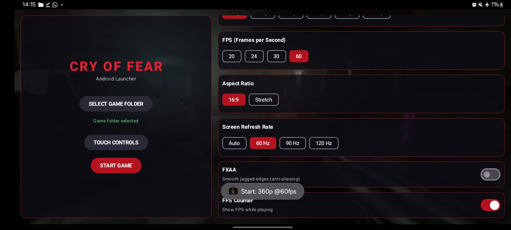
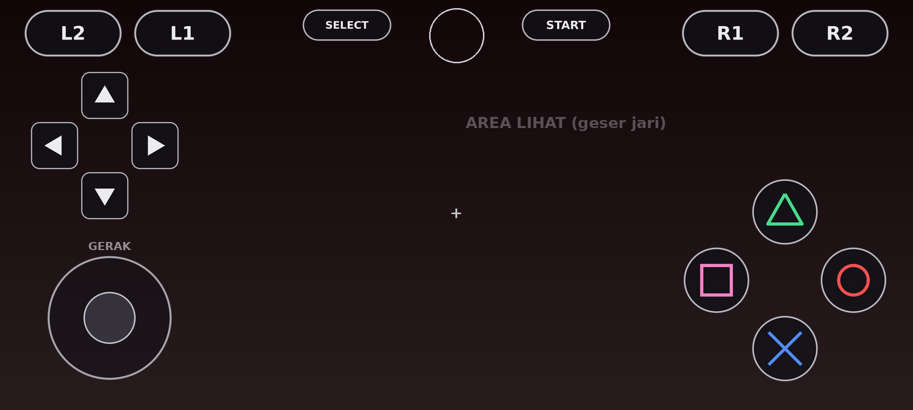

  

<h1 align="center">Cry of Fear — Android Launcher</h1>

  Launcher tidak resmi untuk menjalankan <b>Cry of Fear</b> di Android.

  
  

  

---

## ✨ Fitur Launcher

- 🎮 **Touch Controls** — kontrol sentuh yang bisa diatur sesuai kenyamanan
- 🎬 **Video Background** — tampilan menu dengan background video, bukan gambar statis
- ⚙️ **Settings lengkap** — atur resolusi, FPS, aspect ratio, refresh rate, FXAA, hingga FPS counter
- 📦 **Satu APK** — launcher, engine, dan library game sudah digabung jadi satu file APK

## 📸 Screenshot

  
  &nbsp;&nbsp;
  

---

## 📥 Download Game Cry of Fear

Launcher ini **tidak menyertakan file game**. Kamu tetap butuh file Cry of Fear sendiri sebelum bisa main.

Download Cry of Fear (gratis) di sini:

**➡️ [Cry of Fear — AnkerGames](https://ankergames.net/game/cry-of-fear)**

Setelah download, ekstrak/salin folder game-nya, lalu arahkan launcher ke folder tersebut lewat tombol **Select Game Folder**.

---

## 🎭 Tentang Game

Cry of Fear adalah game *survival horror* gratis yang awalnya dikembangkan sebagai mod untuk Half-Life oleh **Team Psykskallar**, lalu dirilis sebagai game berdiri sendiri (standalone) pada tahun 2013. Game ini mengisahkan Simon Henriksson, seorang remaja yang terbangun sendirian di gang gelap sebuah kota Swedia tanpa ingatan apa pun tentang bagaimana ia bisa sampai di sana. Seiring ia mencoba mencari jalan pulang, Simon dihadapkan pada monster-monster mengerikan, teka-teki yang menegangkan, dan kebenaran gelap tentang masa lalunya sendiri.

Cry of Fear dikenal karena atmosfernya yang mencekam, gaya *fixed-camera* ala horror klasik, sistem kewarasan (sanity), serta cerita psikologis yang berlapis — menjadikannya salah satu game horror indie paling dihormati di komunitas horror gaming.

### 🎮 Gameplay

- **Sistem Kewarasan (Sanity)** — semakin lama berada di kegelapan atau dekat momen menyeramkan, kewarasan Simon menurun, memengaruhi persepsi visual dan audio dalam game
- **Kamera Fixed & Over-the-shoulder** — kombinasi sudut kamera sinematik ala horror lawas dengan mode over-the-shoulder saat combat
- **Manajemen Resource Terbatas** — amunisi, kit medis, dan baterai senter sangat terbatas, memaksa pemain berpikir strategis kapan harus menyerang atau kabur
- **Puzzle Lingkungan** — banyak teka-teki berbasis eksplorasi yang menghubungkan progres cerita dengan lingkungan sekitar
- **Multiple Endings** — pilihan dan tindakan pemain memengaruhi akhir cerita, mendorong replay value
- **Co-op Mode** — mendukung mode kerja sama 2 pemain untuk menjelajahi versi alternatif dari cerita
- **Atmosfer Psikologis** — horror yang dibangun lewat tekanan mental dan ambiguitas naratif, bukan sekadar jumpscare

Cocok buat yang suka horror dengan tensi lambat, cerita berlapis, dan eksplorasi penuh ketegangan.

---

## ⚠️ Disclaimer

- Project ini **tidak berafiliasi** dengan Team Psykskallar maupun pengembang resmi Cry of Fear.
- Launcher ini dibuat untuk tujuan pelestarian & kemudahan akses pada perangkat Android.
- Semua hak cipta game Cry of Fear tetap milik pengembang aslinya.

---

  Kalau project ini membantu, dukung lewat ☕ <a href="https://saweria.co/why01"><b>Saweria</b></a>

